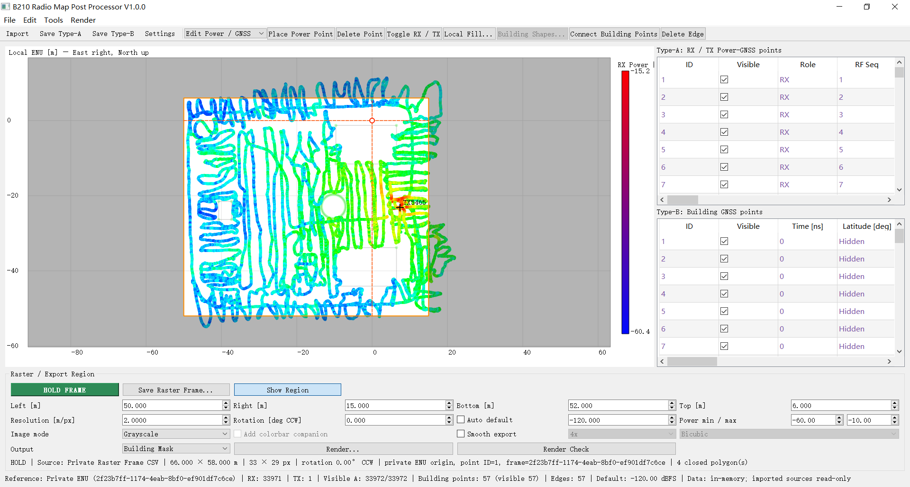

# B210RadioMapPost

B210RadioMapPost is a desktop application for post-processing collected radio-measurement and
site-geometry data. It provides a shared spatial workspace for inspecting measurements, correcting
coordinates and power values, editing building geometry, filling local data gaps, and exporting
aligned raster products for later analysis.

The application is written in C++17 with Qt 5 and runs without radio or GNSS hardware.



## Main features

- Inspect radio measurements, transmitter locations, and building geometry on one ENU map.
- Edit WGS84/ENU coordinates, received power, point roles, visibility, and building topology.
- Place radio points and create rectangular or circular building outlines interactively.
- Generate local samples with inverse distance weighting (IDW) or ordinary kriging.
- Render aligned building masks, transmitter masks, radio maps, and sample-site masks.
- Inspect and fill missing raster cells without altering the original measurement rows.
- Remove geographic information by creating Private ENU copies.
- Generate standard files with Synthetic WGS84 coordinates from Private ENU data and a user-defined
  geographic anchor.
- Recover confirmed measurements from supported raw timeline files.

Most controls provide contextual help. Hover over buttons, table fields, settings, and raster tools
to view their tooltips before changing data or export options.

## Data files at a glance

B210RadioMapPost works with two complementary data types:

- **Type-A** stores radio-measurement points. A point can be an RX measurement or a TX location and
  can contain coordinates, power, timestamp, processing mode, and validity information.
- **Type-B** stores site or building geometry. It contains surveyed vertices and the edges that
  connect them into building boundaries.

A **Raster Frame** extends Type-B geometry with a fixed export region, resolution, rotation, and
power-display settings.

Each of these datasets can also have a **Private** form. Private files remove WGS84 coordinates and
the geographic origin while preserving the local ENU geometry. Matching Private Type-A and Type-B
files share a `LOCAL_FRAME_ID`, which proves that their local coordinates belong to the same frame.

See [Data files and coordinate modes](docs/DATA_FORMATS.md) for field-level explanations,
compatibility rules, and standard/private examples.

## Typical workflow

1. **Import data**
   - Open a Type-A file.
   - Optionally load a matching Type-B file or Raster Frame.
   - Confirm the coordinate mode shown in the status area.
2. **Inspect and edit**
   - Select **Edit Power / GNSS** for radio points or **Edit Building GNSS** for geometry.
   - Select rows or points on the map and edit the required values in the tables.
   - Use tooltips to check whether a control affects only the view, the in-memory data, or exports.
3. **Add or interpolate data**
   - Place manual RX/TX or building points on the ENU map.
   - Use **Local Fill...** to preview IDW or ordinary-kriging samples before appending them.
   - Use **Building Shapes...** to place and discretize closed rectangles or circles.
4. **Configure the raster frame**
   - Set the left, right, bottom, and top extents, resolution, rotation, and power range.
   - Load or hold a validated building frame when aligned building output is required.
5. **Preview and export**
   - Render a building mask, TX mask, radio map, or sample-site mask.
   - Inspect missing cells and optionally apply preview-only completion or assisted fill.
   - Save the aligned image and its JSON sidecar, or save the edited Type-A/Type-B data.

The full step-by-step guide is available in [User guide](docs/USER_GUIDE.md).

## Coordinate and privacy workflows

### Standard data

Standard files contain both WGS84 and local ENU coordinates together with a geographic reference.
B210RadioMapPost validates their consistency during import and maintains synchronized coordinates
when a point is edited.

### Private ENU copies

Use **File > Create Private Copy...** to export data with all WGS84 values and geographic origins
removed. The loaded datasets are not modified.

Private Type-A and Type-B files can be used together only when their `LOCAL_FRAME_ID` values match.

### Synthetic WGS84 copies

When non-empty matching Private Type-A and Private Type-B files are loaded, use:

```text
File > Save > Export Synthetic WGS84 Copies...
```

The application combines the Private ENU coordinates with the **Fallback Geographic Anchor** from
Settings and exports automatically named standard Type-A, Type-B, and, when available, Raster Frame
files. Conversion is performed on copies: the current Private ENU data remains unchanged.

Synthetic WGS84 coordinates are calculated coordinates, not measured GNSS observations. Their
accuracy depends on the supplied anchor and on the meaning and quality of the source ENU frame.

## Build from source

### Requirements

- CMake 3.16 or newer
- A C++17 compiler
- Qt 5.12 or newer with Core, Gui, and Widgets

Use a Qt kit built for the same compiler that will build the application.

### Configure, build, and test

The following placeholders are used:

- `<source_dir>`: repository root
- `<build_dir>`: an out-of-source build directory
- `<qt_kit_path>`: Qt kit containing the Qt CMake package files
- `<compiler_path>`: C++ compiler executable
- `<generator>`: a CMake generator compatible with the compiler

```text
cmake -S <source_dir> -B <build_dir> \
  -G "<generator>" \
  -DCMAKE_PREFIX_PATH="<qt_kit_path>" \
  -DCMAKE_CXX_COMPILER="<compiler_path>"

cmake --build <build_dir> --config Release --parallel
ctest --test-dir <build_dir> -C Release --output-on-failure
```

For a single-configuration generator, set `-DCMAKE_BUILD_TYPE=Release` during configuration and
omit `--config Release` and `-C Release` if the generator does not use configuration subfolders.

### Linux

Install CMake, a C++17 compiler, and the Qt 5 development packages for Core, Gui, and Widgets using
the package manager provided by the Linux distribution. The package names vary by distribution;
they are commonly described as the Qt 5 base development package and Qt 5 development tools.

When Qt 5 is installed in a standard system location, CMake normally discovers it automatically:

```bash
cmake -S <source_dir> -B <build_dir> -DCMAKE_BUILD_TYPE=Release
cmake --build <build_dir> --parallel
ctest --test-dir <build_dir> --output-on-failure
<build_dir>/B210RadioMapPost
```

For a Qt installation outside the system search path, provide its CMake package location:

```bash
cmake -S <source_dir> -B <build_dir> \
  -DCMAKE_BUILD_TYPE=Release \
  -DCMAKE_PREFIX_PATH="<qt_kit_path>" \
  -DCMAKE_CXX_COMPILER="<compiler_path>"
cmake --build <build_dir> --parallel
ctest --test-dir <build_dir> --output-on-failure
```

The application uses Qt's offscreen platform for its automated tests, so the test suite can also
run in a non-interactive Linux build environment.

### PyQt5 alternative

If a C++ build is not desired, the project can be used as a functional reference for a PyQt5 port.
The Qt widget structure, signals and slots, table models, file workflows, and numerical modules can
be translated into Python/PyQt5 equivalents.

A PyQt5 translation is not included in this repository. A port should preserve the documented file
formats, coordinate checks, privacy rules, raster alignment, and regression tests rather than only
reproducing the visible interface.

## Citation

If B210RadioMapPost contributes to a publication, please cite our work:

```bibtex
@misc{ming2026fieldradiomap,
  author       = {Ming, L. and Wang, L. and Sun, Y. and Chen, X. and Wang, J. and Wang, Y.},
  title        = {{FieldRadioMap}: Outdoor Received-Power Measurements and Paired Propagation Simulations for Radio Map Reconstruction},
  publisher    = {Zenodo},
  month        = nov,
  day          = {05},
  year         = {2026},
  doi          = {10.5281/zenodo.23974604},
  url          = {https://doi.org/10.5281/zenodo.23974604},
  note         = {Dataset}
}
```
```bibtex
@misc{ming2026sapbdw,
      title={Simulation-Assisted Radio Map Reconstruction with Sparse Field Measurements}, 
      author={Lang Ming and Longhui Wang and Yazhou Sun and Xi Chen and Jian Wang and Yu Wang},
      year={2026},
      eprint={2611.33202},
      archivePrefix={arXiv},
      primaryClass={eess.SP},
      url={https://arxiv.org/abs/2611.33202}, 
}
```


### AI-assisted development disclosure

Large language model tools assisted with parts of the interaction-front-end design and its software
implementation. The project authors selected, reviewed, integrated, and tested the resulting work
and remain responsible for the scientific methods, data interpretation, validation, and released
software.

## Documentation

- [Data files and coordinate modes](docs/DATA_FORMATS.md)
- [User guide](docs/USER_GUIDE.md)

## Release Notes

* 2026/11/27

  This release open-sources the post-processing software and its associated dataset. Currently, the [Zenodo](https://doi.org/10.5281/zenodo.23974604) repository provides only the processed result images generated by the post-processing software. The original `CSV` data files that the software takes as input are expected to be released after the manuscript is formally accepted, enabling users to export results at different resolutions or carry out custom post-processing.
